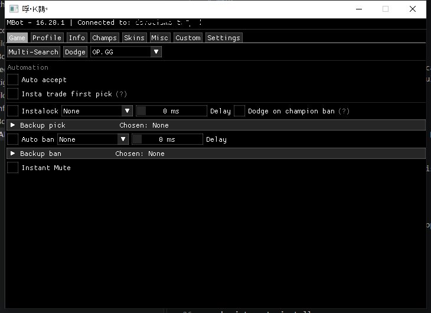
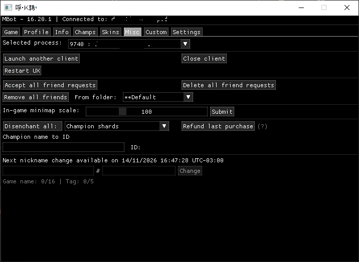

# MBot

MBot is a Windows desktop companion for League of Legends. It provides a
single interface for client conveniences, player information and locally saved
preferences.

## Features

- Ready-check assistance and configurable champion selection preferences
- Pick-order exchange controls
- Champion and cosmetic collection browsing
- Player profile lookup and shortcuts to popular statistics websites
- Local account profiles for easier switching through the official client
- Customizable interface and settings stored only on the user's computer

This project is based on [KBotExt](https://github.com/KebsCS/KBotExt) and keeps
the original attribution.

This repository is provided for study purposes only. It does not distribute
executables. Each user is responsible for reviewing the source code, compiling
it locally and deciding whether and how to use it.

## Screenshots

### Main

### Misc

